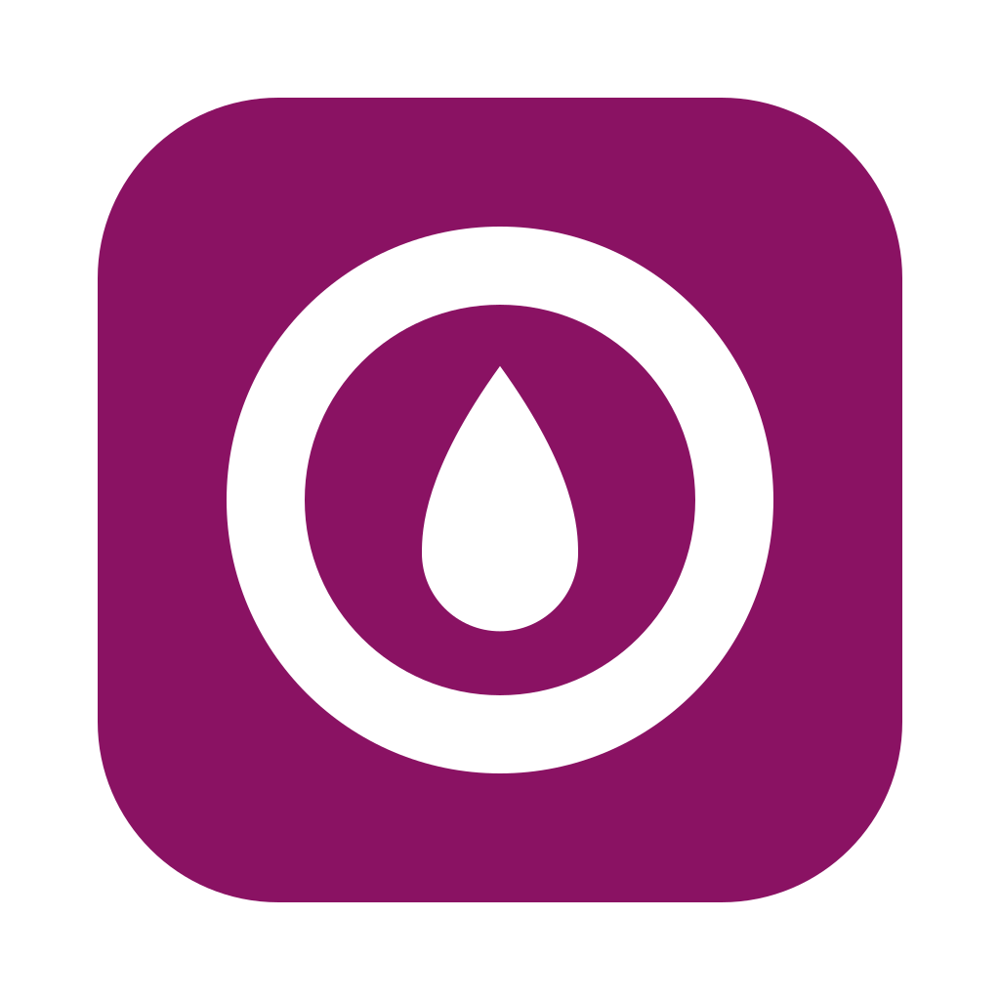

<p align="center"></p>

# LibreLibreLink

A native **macOS menu bar app** that shows the glucose readings of a **FreeStyle Libre 2 Plus**
sensor: current value and trend arrow at the top right of the screen, alarms, a daily chart,
a logbook, reports and a printable AGP PDF for your doctor.

```
 123 ↗      ← normal reading (monochrome)
 ⬤↓ 64      ← low: icon and color only when something needs attention
```

> [!WARNING]
> **LibreLibreLink is not a medical device.** It does not replace LibreLink's official alarms,
> and it must not be used to make treatment or dosing decisions. Readings arrive about a
> minute late and the app has not yet been validated against LibreLink (see [Status](#status)).
> It is not affiliated with or endorsed by Abbott.

## How it works

```
Libre 2 Plus ──BLE──▶ iPhone (LibreLink) ──▶ LibreView cloud ──LibreLinkUp API──▶ Mac (LibreLibreLink)
```

Your phone keeps running the official **LibreLink** app, which uploads every reading to
Abbott's cloud. LibreLibreLink signs in as a **LibreLinkUp** follower and polls the same
API that the LibreLinkUp app uses, once a minute. Nothing touches the sensor, so LibreLink
keeps working exactly as before.

### Why not read the sensor directly over Bluetooth?

That was the original goal. The LibreLink Android app (2.13.1) was reverse-engineered
statically to find out (all notes are in [`re/`](re/), in Spanish):

- The Mac has no NFC, and NFC is always needed once per sensor to enable BLE streaming.
- The app picks one of two security generations per sensor from `patchInfo[2]`.
  **Gen1** sensors could be read from a Mac after the NFC step. **Gen2** sensors protect
  the unlock and the decryption with WhiteCryption white-box crypto inside Abbott's
  `libDataProcessing.so`, which cannot practically be reimplemented.
- Libre 2 Plus sensors sold in the Americas (serial `3MH0…`) are, as far as anyone knows,
  gen2. So the project switched to the cloud route.

The BLE/NFC findings are kept in `re/` in case a gen1 sensor ever turns up.

## Features

**Menu bar**
- Value and trend arrow (`LO` below 40 mg/dL, `HI` above 500). It stays monochrome while
  everything is fine and gets an icon and a color when there is a problem: urgent low
  (< 55), low, high, stale reading (≥ 10 min), no sensor signal (≥ 20 min), no connection to
  LibreLinkUp, sensor warming up, or account needs attention (sign in / accept terms).
- The panel explains every active problem, shows how many days the sensor has left, and
  lets you switch between patients when you follow more than one.

**Alarms** (off by default)
- macOS notifications for low, high, urgent low, signal loss and *low coming soon*. *Low
  coming soon* fires when the trend over the last 15 min would cross the low threshold
  within 15 min. One notification per episode, repeated every 5 min while it lasts.
- Optional **spoken alarms** with the system voice, which still sound when Focus or Do Not
  Disturb silences notifications.
- Adjustable thresholds (low 60–100, high 120–400 mg/dL), plus sensor notices: new sensor,
  warm-up finished, ending in 3 days / 1 day / 1 hour, ended.
- **Smarter alarms**: *falling fast* (≥ 2 mg/dL per minute while still in range), *only alert
  if the high lasts* 30 min to 3 h (so a short post-meal spike stays quiet), **night
  thresholds** with an option to silence highs at night, and **escalation**: a low nobody
  attends to for 10 min repeats every 2 min and is read aloud.
- **Notification actions**: snooze 15 / 30 / 60 min, or on a low *I ate · remind me in 15 min*
  (the 15-15 rule). Urgent low can only be snoozed by treating it, for at most 15 min.
- **Alarm diagnostics** tell you whether alarms can actually reach you, or why not
  (permission denied, notification style "None", muted Mac, not launching at login, …).

**Mac integration**
- **Widgets** for the desktop and Notification Center: *current glucose* (small), *glucose and
  chart* (medium, last 3 h) and *daily summary* (large: 12 h chart, today's time in range,
  average, lows and sensor). Right-click the desktop ▸ Edit Widgets.
- **Shortcuts / Siri / Spotlight** actions: *Get glucose* (returns the number, e.g. "if below
  70, pause the music"), *Today's summary*, *Add to logbook*, *Snooze alarms* / *Resume
  alarms*, *Discreet mode* and *Open LibreLibreLink*. Ask Siri "What's my glucose in
  LibreLibreLink".
- **Shortcuts on alarms**: run one of your own shortcuts when a low, a high or signal loss
  starts, and when glucose is back in range.
- **Global keyboard shortcut** to open the panel from any app (⌥⌘G by default).
- **Discreet mode**: hides the value in the menu bar and widgets, by hand (the eye button in
  the panel) or automatically while the camera or microphone is in use (calls and meetings).

**Window** (Today, Logbook, Reports and Settings)
- **Today**: big current value, time in range, daily average and an interactive chart
  (6 h / 12 h / 24 h / by day).
- **Logbook**: log carbs, rapid and long-acting insulin, exercise, fingerstick readings
  and notes. Shows the post-meal rise, peak and time back in range per meal, and compares
  the sensor with your meter (mean difference, MARD, 15/15).
- **Reports** (7 / 14 / 30 / 90 days): average, GMI (estimated A1c), CV, sensor usage,
  time in range, low episodes and daily patterns (percentile bands).
- **Export PDF**: a one-page AGP report with the 5 international consensus ranges,
  the AGP profile and the last 14 days.
- **Import** a LibreView CSV export to backfill months of history.
- mg/dL or mmol/L, configurable target range, English and Spanish (follows the system
  language).

**History.** LibreLinkUp only returns about 12 hours of data, so the app stores every reading
it sees in a local SQLite database at
`~/Library/Application Support/LibreLibreLink/history.sqlite`. Your LibreLinkUp credentials are
kept in the macOS **Keychain**. Nothing is sent anywhere except to Abbott's LibreLinkUp API.

## Requirements

- macOS 15 (Sequoia) or later.
- **Xcode** 16 or later (the Command Line Tools are not enough: widgets and Shortcuts actions
  are app extensions) and [XcodeGen](https://github.com/yonaskolb/XcodeGen)
  (`brew install xcodegen`), which generates the Xcode project from `mac/project.yml`.
- A FreeStyle Libre sensor used with the **LibreLink** phone app (iPhone or Android), and a
  **LibreLinkUp** account that follows it. You can skip this and try the app in
  [demo mode](#try-it-without-an-account-demo-mode).

## Installation

### 1. Set up LibreLinkUp (once)

1. On your phone, in **LibreLink**: Menu ▸ **Share** ▸ **Connected Apps / LibreLinkUp** ▸
   invite an email address. Using a different email from your LibreLink account works best.
2. Install **LibreLinkUp** on a phone, create an account with that email, **accept the
   invitation** and accept the terms of use. If the Mac app later says you need to accept
   terms, this is the step it means.

### 2. Build and install the app

```bash
git clone <this repository>
cd LibreLibreLink/mac
swift test                      # optional: run the LibreKit test suite
scripts/make-app.sh --install   # builds dist/LibreLibreLink.app and copies it to ~/Applications
open ~/Applications/LibreLibreLink.app
```

`make-app.sh` generates the Xcode project, builds the app with its widget and Shortcuts
extensions in release mode and signs everything to run locally (ad-hoc, no Apple Developer
account). It runs as a menu bar agent with no Dock icon (the icon
only appears while the main window is open). Run it without `--install` to only produce
`mac/dist/LibreLibreLink.app`.

### 3. First launch

1. Click the new item in the menu bar and sign in with your **LibreLinkUp** email and
   password. The region (US, EU, LA, …) is detected automatically through the API redirect.
2. If macOS asks for Keychain access, choose **Always Allow**.
3. Click **Open window** in the panel and go to **Settings** to turn on notifications, set
   thresholds and enable **Open at login**.

> [!NOTE]
> Notifications and *Open at login* only work from the packaged `LibreLibreLink.app`, not
> from `swift run`. Because the app is not signed with an Apple Developer ID, Focus / Do Not
> Disturb may silence its notifications. Turn on spoken alarms if you need them to get
> through.

## Try it without an account (demo mode)

A fake server answers the real client's requests with invented data (two patients, a typical
day, 14 days of history in memory). It never touches your Keychain or the history database.

- In the sign-in panel: **Try without an account (demo data)**, or
- `open ~/Applications/LibreLibreLink.app --args --demo`, or
- `swift run LibreLibreLink --demo` from `mac/`.

A **Demo mode** bar lets you pick a scenario: normal day, high, low coming soon, low, urgent
low, LO/HI, stale reading, signal loss, connection error, must accept terms, no patients,
sensor ending, new sensor (warming up), or an **automatic tour** that cycles through them.
To see the other language: `open dist/LibreLibreLink.app --args --demo -AppleLanguages "(en)"`.

## Command line tool

`llu` is a small diagnostic CLI that signs in, lists the patients you follow and prints
their latest reading:

```bash
cd mac
LLU_EMAIL=you@example.com LLU_PASSWORD=... swift run llu   # optional: LLU_REGION=eu|us|la|…
swift run llu --demo high                                  # demo scenario, no account
```

## Repository layout

| Path | Contents |
| --- | --- |
| `mac/Sources/LibreKit` | Core library: LibreLinkUp client, models, status and alarm logic, forecast, statistics, SQLite history, logbook, LibreView CSV import, demo server. |
| `mac/Sources/LibreLibreLink` | SwiftUI app: `MenuBarExtra`, main window, settings, AGP PDF, notifications, Keychain, global hotkey, discreet mode. |
| `mac/Widgets` | WidgetKit extension (small, medium and large widgets). |
| `mac/Intents` | App Intents extension (Shortcuts, Siri and Spotlight actions). |
| `mac/project.yml` | XcodeGen spec for the app and its extensions (the `.xcodeproj` is generated, not tracked). |
| `mac/Sources/llu` | Diagnostic CLI. |
| `mac/Tests/LibreKitTests` | Unit tests (`swift test`). |
| `mac/Localization` | String Catalog (Spanish base, English translation). |
| `mac/scripts` | `make-app.sh` (Xcode build), `make-icon.swift` (app icon from `assets/logo.svg`), `sync-strings.sh` + `translations_en.py` (i18n). |
| `mac/Resources` | `AppIcon.icns`, generated from the logo. |
| `assets/logo.svg` | App logo (source of the icon). |
| `re/` | Reverse-engineering notes on LibreLink 2.13.1: NFC, BLE, native library, alarm/UI requirements, and `HANDOFF.md` with the project state. |
| `ios/LibrePatchInfo` | Read-only iOS helper that reads a sensor's `patchInfo` over NFC to classify gen1/gen2 (needs a paid Apple Developer account for the NFC capability). |
| `PLAN.md` | Project plan and phases (Spanish). |

`docs/` (APK, user guide, reference material) and `work/` (extracted APK, native libraries,
evidence) are not tracked by git.

### Translations

Spanish is the base language: the strings in the code are the catalog keys. After changing
UI text:

```bash
cd mac
scripts/sync-strings.sh              # extract strings from the code into the catalog
python3 scripts/translations_en.py   # apply English translations, report missing ones
scripts/make-app.sh                  # compile the catalog into the app
```

More detail (in Spanish) is in [`mac/README.md`](mac/README.md).

## Credits

- The LibreLinkUp API usage follows [`pylibrelinkup`](https://github.com/robberwick/pylibrelinkup).
- Sensor generation references from the open-source [DiaBLE](https://github.com/gui-dos/DiaBLE) project.

FreeStyle Libre, LibreLink, LibreLinkUp and LibreView are trademarks of Abbott. This is an
independent personal project.
